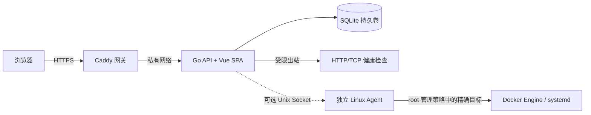

# Project Hub

Project Hub 是自托管的项目目录、健康检查面板和受限服务控制台。项目入口、分类、收藏和在线状态集中在一个 Web 界面中；主应用采用 Go 模块化单体，Vue 3 提供前端，Linux Agent 作为独立进程按主机管理员的显式策略执行有限服务操作。Agent 离线时，项目目录和网络健康检查仍可使用。

> 当前生产部署曾在 Orange Pi Zero 3W / Debian 13 ARM64 上验收。Phase 12 的自动化复核和隔离恢复通过；手机/浏览器 CA 信任、路由器 DHCP 保留、异机备份、长期冷启动稳定性、生产管理员密码轮换和真实项目录入仍有人工验收项。详见 [Phase 12 验收记录](PHASE12_ACCEPTANCE.md)，不要把待人工完成项视为已通过。

## 功能与安全边界

- 项目目录支持分类、收藏、搜索、项目链接和持久化存储。
- HTTP(S) 与 TCP 健康检查使用明确配置的目标、超时、阈值和历史样本；Agent 状态来自实际主机查询。Agent 离线不会被误报为目标服务已停止。
- 管理接口使用会话认证、服务端 RBAC、CSRF 与同源校验。管理路由在认证/授权中间件之外不会注册。
- API 不挂载 Docker Socket，也不执行 shell 命令。浏览器经 Caddy HTTPS 访问；API 容器没有宿主机发布端口。
- Agent 使用 Unix Socket 和 root 管理的策略文件，仅接受精确配置的目标 ID 与固定动作。默认拒绝未授权目标；新增项目不会授予宿主机权限。
- Docker 与 systemd 控制是可选功能；不安装 Agent 或不给目标配置动作权限时，控制操作不可用。
- 健康检查对目标、DNS 结果、重定向和私网 CIDR 执行限制，以降低 SSRF 风险。

## 架构概览



API 与 Agent 是独立部署单元；四个开发工作包共同维护在同一个 Git 仓库。SQLite 编号迁移由应用启动时事务执行。生产数据和备份必须保存在受保护的持久化位置；开发与测试命令使用临时数据库，不得指向生产卷或真实业务容器。

## 工程结构

```text
.
├── cmd/
│   ├── api/                 # API 进程、HTTP 路由与处理器、启动/备份/恢复命令
│   └── agent/               # 独立 Linux Agent 入口
├── internal/
│   ├── agent/               # Agent 客户端、策略、Unix Socket、Docker/systemd 后端
│   ├── auth/                # 密码哈希、会话、登录限流与用户认证
│   ├── categories/          # 项目分类领域逻辑
│   ├── config/              # 环境变量与运行配置校验
│   ├── events/              # SSE 事件发布/订阅
│   ├── ids/                 # ID 生成
│   ├── jobs/                # 异步服务任务与审计记录
│   ├── migrate/             # SQLite 编号迁移
│   ├── monitor/             # 健康检查调度、状态、历史与 SSRF 防护
│   ├── projects/            # 项目目录、链接与收藏
│   ├── rbac/                # 角色与权限策略
│   ├── store/               # SQLite 存储及事务
│   └── webapp/              # 嵌入并托管前端构建产物
├── migrations/              # 001 起的 SQL schema 迁移，embed 到 API
├── web/                     # Vue 3 + TypeScript + Vite 前端及测试
├── deploy/                  # Agent 示例策略、systemd 与 Orange Pi LAN 部署文件
├── docs/                    # API、Agent、部署、运维及设计/计划文档
├── scripts/                 # 隔离 smoke test、NVMe 只读诊断及其测试
├── .github/workflows/ci.yml # Go、前端、E2E 与多架构镜像 CI
├── ARCHITECTURE.md          # 安全边界、领域模块、数据流和部署设计
├── TASKS.md                 # 七阶段原始验收清单及后续阶段记录
├── PHASE11_ACCEPTANCE.md    # 正式上线验收证据与待办
└── PHASE12_ACCEPTANCE.md    # 日常使用交付、实测结果与人工验收步骤
```

### Go 模块职责

| 位置 | 责任 | 主要依赖/边界 |
|---|---|---|
| `cmd/api` | HTTP/API 组合根、路由和生命周期；提供 `bootstrap-admin`、数据库备份和恢复入口 | 组合 `internal` 包；API 不直接调用 Docker Engine |
| `cmd/agent` | Agent 进程和可选后端配置 | 单独运行；受 root 管理的策略文件约束 |
| `internal/auth`, `internal/rbac` | 身份认证、会话、角色授权 | 所有管理接口必须经过认证与角色检查 |
| `internal/projects`, `internal/categories` | 项目目录、分类及用户收藏 | 不代表宿主机授权 |
| `internal/monitor` | 定时探测、状态转换和样本保留 | 目标由管理员配置；出站地址经过 SSRF 策略校验 |
| `internal/agent`, `internal/jobs` | Agent 协议、目标授权、动作队列和审计 | Agent 再次校验目标与动作；失败时拒绝，不自动重放中断任务 |
| `internal/store`, `internal/migrate` | SQLite 打开、schema 和数据库迁移 | 参数化查询、外键、事务；生产数据库不得用开发命令覆盖 |
| `internal/events` | 实时事件广播 | SSE 有认证、队列上限及前端轮询后备 |

Go package 的边界以实际接口和测试为准；扩展功能时先阅读现有服务/存储测试，避免把领域逻辑塞进 HTTP handler。

## 开发环境

### 版本与工具

- Go `1.26.0` 或兼容的 `1.26.x`（见 `go.mod`）
- Node.js `24.21.0`（根目录 `.nvmrc`）和 npm `11.19.0`（`web/package.json`）
- Python 3 和 `curl`：运行本地隔离 smoke test
- Docker Engine 与 Docker Compose 插件：只在需要本机 Compose 部署时使用
- `make`：快捷命令；Windows 开发者可在 WSL 中运行 shell 脚本

使用 Node 版本管理器切换至 `.nvmrc` 对应版本，然后从仓库根目录运行：

```sh
nvm install
nvm use
node --version   # v24.21.0
npm --version    # 11.19.0
npm --prefix web ci
```

### 构建与测试

```sh
# Go：单元/集成测试、竞态检查、静态检查
go test ./...
go test -race ./...   # 需 48-bit VA 主机；arm64 39-bit VA 内核会直接 abort（见下）
go vet ./...

# 前端
npm --prefix web run test:unit
npm --prefix web run typecheck
npm --prefix web run build
npm --prefix web run test:e2e

# NVMe 脚本：fixture 测试，不访问实际 NVMe 或修改 PCIe 状态
python3 -m unittest discover -s scripts -p 'test_nvme_health_check.py' -v

# Go API 隔离端到端 smoke：临时 DB、loopback 端口、临时管理员
make smoke-local
```

**arm64 上跑 `-race` 的前置条件**：Go 的 ThreadSanitizer 在 linux/arm64 上要求 48-bit 虚拟地址空间。Raspberry Pi OS 内核（如 `6.18.50+rpt-rpi-v8`）编成 39-bit VA（`CONFIG_ARM64_VA_BITS=39`），此时 `go test -race ./...` 会对每个**含测试的**包在启动阶段直接 abort —— `FATAL: ThreadSanitizer: unsupported VMA range` / `Found 39 - Supported 48`，**没有任何测试真正执行**，但 Go 会把这些包报成 FAIL。在这类内核上改用 `go test ./...`；竞态检查请在 48-bit VA 主机上运行（x86_64，或 48-bit 的 arm64），CI 已固定执行 `go test -race ./...`。自查内核配置：

```sh
grep CONFIG_ARM64_VA_BITS /boot/config-$(uname -r)
```

`make smoke-local` 会在 Linux/WSL 临时目录编译并启动 API，验证 bootstrap、健康检查、SPA、登录和一项认证后的项目写入，然后清理临时目录。它不会连接 Docker Socket、systemd 或生产数据库。首次运行会在 `web/` 执行 `npm ci` 并构建前端。CI 工作流还会构建 Linux amd64/arm64 API 与 Agent，并构建不推送的多架构镜像。

### 本地开发循环

前端开发服务器默认把 `/api` 转发到 `http://127.0.0.1:8080`。可先启动只监听 loopback 的开发 API，再启动 Vite：

```sh
mkdir -p data
PROJECTHUB_LISTEN=127.0.0.1:8080 \
PROJECTHUB_DB_PATH="$PWD/data/projecthub-dev.db" \
go run ./cmd/api
```

另开终端运行：

```sh
npm --prefix web run dev
```

若需完整登录/写入流程，使用隔离的本地管理员密码文件完成首次初始化；初始化参数、安全权限及数据库命令见 [部署与初始化](docs/deployment.md)。不要把生产密码、`.env`、证书私钥、Agent 策略或生产 SQLite 文件复制进仓库。不要在本地验证时启用真实 Docker/systemd 目标。

前端源码在 `web/src`，组件单测与组件同目录；浏览器验收规格位于 `web/e2e`。API handler 测试在 `cmd/api`，领域/存储测试与各自 Go package 同目录。更改认证、管理路由、Agent 策略、迁移或部署安全边界时，应补充覆盖拒绝路径的测试，并遵循 [Agent 安全说明](docs/agent.md) 与 [API 路由权限表](docs/api.md)。

## 部署与日常运维

推荐先在专用 Linux 主机按标准 Compose 部署；Orange Pi 内网配置、私有 CA 和 systemd 启动依赖见 [LAN 部署指南](docs/lan-deployment.md)。这些是不同部署配置，不是独立仓库或独立服务拆分。

| 文档 | 内容 |
|---|---|
| [ARCHITECTURE.md](ARCHITECTURE.md) | 架构、信任边界、数据流、认证、Agent 与部署约束 |
| [docs/api.md](docs/api.md) | API 路由、角色要求、会话/CSRF 行为 |
| [docs/agent.md](docs/agent.md) | Linux Agent 安装、root 策略、目标授权和恢复 |
| [docs/deployment.md](docs/deployment.md) | Compose 部署、初始化、升级/回滚、凭据保护 |
| [docs/lan-deployment.md](docs/lan-deployment.md) | Orange Pi LAN HTTPS、CA、持久化、启动依赖与故障排查 |
| [docs/operations.md](docs/operations.md) | 在线备份、隔离恢复、NVMe 诊断及故障处理 |
| [TASKS.md](TASKS.md) | 七阶段开发与验收清单、验证记录 |
| [PHASE11_ACCEPTANCE.md](PHASE11_ACCEPTANCE.md) / [PHASE12_ACCEPTANCE.md](PHASE12_ACCEPTANCE.md) | 生产环境实测证据、未完成项及人工验收步骤 |

生产数据盘挂载依赖是 fail-closed 保护的一部分。不要通过跳过挂载依赖、删除卷或清空目录来使服务启动；不要对真实业务容器执行 Agent 测试。备份、恢复和 NVMe 检查命令见 [运维文档](docs/operations.md)。

## 贡献与变更约定

1. 先阅读 [ARCHITECTURE.md](ARCHITECTURE.md) 及对应模块测试，遵守单仓库模块化单体 + 可选独立 Agent 的边界。
2. 一个变更聚焦一个功能；安全相关改动优先添加明确的拒绝/权限回归测试。
3. 按改动范围运行 Go、前端或脚本对应检查；部署文档不能替代生产验证，未执行的验收项保持未通过。
4. 修改 schema 时新增编号迁移并验证已有数据库升级及隔离备份恢复，不要重写已发布迁移。
5. 不提交 `.env`、数据库/备份、证书私钥、管理员口令、生产 CA 私钥或包含真实凭据的 Agent policy。配置示例使用占位值。
6. 每阶段提交清晰的 Git 记录，验收结果写明所执行命令、实测输出及剩余限制。

当前尚待设备所有者完成的项目包括真实终端证书信任、路由器地址保留、管理员生产凭据轮换、异机备份落地、真实项目录入、遗留验证资源复核清理，以及多次冷启动稳定性观察。具体步骤和证据位置见 Phase 12 记录。
